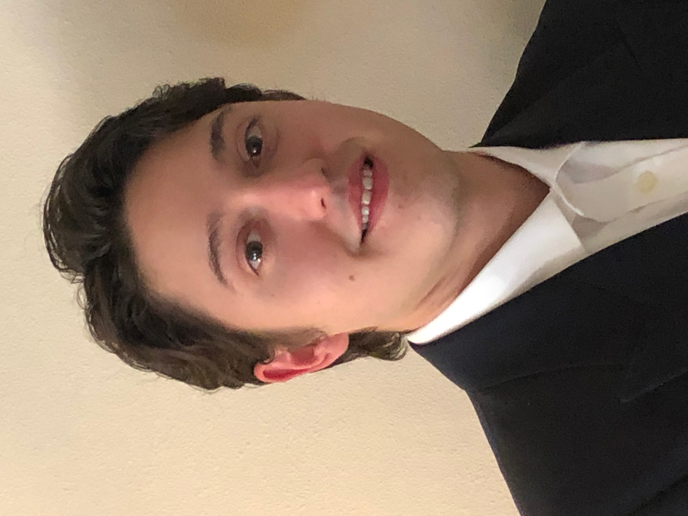

  
  

    

      I am a fifth-year PhD student in <a href="https://www.cmu.edu/dietrich/statistics-datascience/index.html">Statistics</a> at <a href="https://www.cmu.edu/">Carnegie Mellon University</a>.
    

    

      I am very lucky to be advised by <a href="https://web.stanford.edu/~aramdas/">Aaditya Ramdas</a> and <a href="https://www.stat.cmu.edu/~cshalizi/">Cosma Shalizi</a>.
    

    

      Here is my <a href="https://mwiecksosa.github.io/cv.pdf">CV</a>. You can reach me at mwiecksosa AT cmu FULLSTOP edu.
    

  

My research interests are at the intersection of:
- **Causality** (invariant causal prediction, conditional independence testing, causal structure learning, mechanism discovery)
- **Dependence** (high-dimensional time series, time-varying networks, spatiotemporal data, nonlinear stochastic dynamics)
- **Machine learning** (deep neural networks, transformers, foundation models, large language models)
- **Simulation-based inference** (model selection, misspecification, identification, random features)
- **Sequential anytime-valid inference** (confidence sequences, strong approximations, beyond martingale dependence)

**Research**

*Statistics journals*
- The dynamic generalized covariance measure for conditional independence testing with nonstationary time series (with Michel Haddad and Aaditya Ramdas). Accepted for publication in the Journal of Business & Economic Statistics. [arXiv](https://arxiv.org/abs/2504.21647). [Slides](https://mwiecksosa.github.io/dGCM_slides.pdf). [Code](https://github.com/mwiecksosa/dgcm).
- Estimating dynamic models by matching random features (with Cosma Shalizi). Submitted to the Journal of the Royal Statistical Society, Series B. [arXiv](https://arxiv.org/abs/2607.21916). [Code](https://github.com/mwiecksosa/random_features).

*Machine learning conferences*
- Generative sequence modeling for infinite memory processes via predictive states (with Cosma Shalizi). Submitted to ICLR 2027. [arXiv](https://arxiv.org/abs/2609.38524).
- Compressed simulation-based inference: neural posterior estimation for massive data via low-dimensional sketches (with Cosma Shalizi). Available upon request.

*Interdisciplinary journals*
- Dynamic models with p parameters are identified by 2p+1 random features (with Cosma Shalizi). Major revision at Physical Review E. [arXiv](https://arxiv.org/abs/2607.16035). [Code](https://github.com/mwiecksosa/random_features). 

*Current projects*
- Distribution-uniform anytime-valid inference for time series (with Aaditya Ramdas).
- Anytime-valid invariance testing for time series (with Aaditya Ramdas).
- Simulation-based inference through random features (with Cosma Shalizi). 
- Pretraining large predictive state space models (with Cosma Shalizi). 

**News**
- October 2026: I'll be attending the [Workshop on Information-Theoretic Methods for Learning Dynamics](https://www.nitmb.org/event/image-based-scientific-machine-learning-for-theories-of-biological-dynamics-across-scales-information-theoretic-methods-for-learning-dynamics/) in February 2027 at the National Institute for Theory and Mathematics in Biology.
- June 2026: I gave an invited talk at the [9th International Workshop in Sequential Methodologies (IWSM 2026)](https://dr-baron.github.io/IWSM-2026/IWSM_program.pdf) at American University.
- April 2026: I was awarded the DeGroot-Goel Fellowship for 2026 by the CMU Statistics & Data Science Department faculty.
- April 2026: I successfully proposed my thesis. Topics: generative modeling and dependent data.
- October 2025: I presented a poster at the [2025 Workshop on Neural Simulation-Based Inference](https://www.cmu.edu/dietrich/statistics-datascience/stamps/workshop/workshop-archive/posters-fall25.html) at Carnegie Mellon University.
- September 2024: I presented a poster at the [2024 NBER-NSF Time Series Conference](https://drive.google.com/file/d/1xaHn0LlmjPAeaHCU8wXiIo2pKTohcC8i/view) at the University of Pennsylvania.
